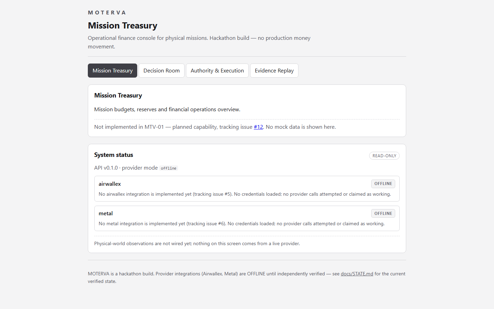
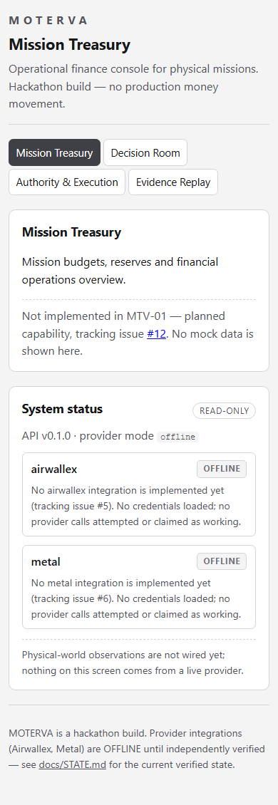

# MOTERVA · Mission Treasury

**Mission-scoped financial autonomy engine for physical operations (hackathon build).** Repo name is `Morteva` (as created); product name is `MOTERVA`. This is not a production banking service.

> **Truth as of 2026-11-02:** The repository contains engineering documentation **plus a runnable local skeleton delivered by MTV-01 (issue #3)**: a typed monorepo with a Fastify API (genuine health + honest read-only status routes) and a Vite/React web shell, unit + Playwright tests, and CI. **No financial integration exists yet** — Airwallex and Metal are OFFLINE, no provider credentials are read, and no sandbox/testnet call has been made. Read [STATE](docs/STATE.md) before making claims.

## Quickstart (verified commands)

Prerequisites: **Node.js ≥ 22** (developed and CI-tested on Node 24) and **npm ≥ 10**. Nothing else — no database, no docker, no accounts.

```bash
npm ci            # cold install from the committed lockfile
npm run dev       # API on http://127.0.0.1:8787, web on http://127.0.0.1:5173
```

The web app is the honest shell: primary navigation to the planned capabilities (each labelled with its tracking issue — no mock data) and a System status card fed by `GET /api/system/status` that reports providers **OFFLINE** until issues #5/#6 ship verified adapters.

### All commands

| Command                 | What it does                                                                  |
| ----------------------- | ----------------------------------------------------------------------------- |
| `npm ci`                | Cold install exactly from `package-lock.json` (fails if lockfile is tampered) |
| `npm run dev`           | Both servers in watch mode (API + web)                                        |
| `npm run lint`          | ESLint across all workspaces                                                  |
| `npm run format:check`  | Prettier check                                                                |
| `npm run typecheck`     | `tsc` strict across packages, apps, e2e and tests                             |
| `npm run test:unit`     | Vitest per workspace (domain money invariants, API routes/config, providers)  |
| `npm run build`         | Compile packages + API (`tsc`), build web (`vite build`)                      |
| `npm run test:e2e`      | Build, then Playwright chromium against the real servers                      |
| `npm run check:docs`    | Markdown link integrity + secret patterns in docs                             |
| `npm run check:secrets` | Secret-pattern scan over source files                                         |

`npm ci` and every script above run on a cold checkout in CI (`.github/workflows/ci.yml`, Linux/Node 24). A red CI check blocks a green claim — see docs/09.

### Optional local configuration

All configuration is optional and safe by default (see [.env.example](.env.example) — **variable names only**). Copy it to `.env` and edit locally; `.env` is gitignored. Invalid values (bad port, malformed origin, unsupported provider mode) make the API **refuse to start** with an actionable message and exit code 1.

## Runbook

- **Start:** `npm run dev` (or `npm run build && npm run start -w @moterva/api` for the compiled server).
- **Liveness:** `curl http://127.0.0.1:8787/healthz` → `{"status":"ok",...}`. This is process liveness only; it never claims provider state.
- **Honest status:** `curl http://127.0.0.1:8787/api/system/status` — providers list with `OFFLINE` labels and a simulation notice. The UI renders this verbatim and shows a `DEMO_SIMULATED` notice in simulated mode.
- **Failure states:** backend offline → the web shell shows an explicit "API offline" alert with a Retry button (covered by E2E). Config missing/invalid → API exits 1 before binding a port.
- **Financial endpoints:** none exist; every unknown `/api/*` route fails closed with a 404 (negative-tested). Provider financial writes arrive only with issues #5/#6 behind authentication.
- **Rollback:** `git revert` — no migrations or deployments exist yet.

## Repository layout

```
apps/web            Vite + React 19 web shell (honest status UI, primary navigation)
apps/api            Fastify 5 API: /healthz, /api/system/status, fail-closed routing, env validation
packages/domain     Pure typed money + status contracts (integer minor units; no float money)
packages/providers  Provider port contracts + OFFLINE descriptors (no provider calls exist)
e2e/                Playwright specs (smoke, API-offline error state, screenshot capture)
docs/               Engineering documentation, ADRs and evidence assets
```

Stack rationale and the persistence/auth/jobs/deployment plan: [ADR 0001](docs/adr/0001-stack-and-runtime.md).

| App shell (desktop 1440×900)                                 | App shell (mobile 390×844)                                 |
| ------------------------------------------------------------ | ---------------------------------------------------------- |
|  |  |

## Start here

- [Release epic #2](https://github.com/CosmasMandikonza/Morteva/issues/2): goals and prize-oriented release requirements.
- [Foundation review PR #1](https://github.com/CosmasMandikonza/Morteva/pull/1): audit history, findings and implementation contract.
- [Delivery dependencies / decision register](docs/07_DELIVERY_ORDER_AND_DECISIONS.md)
- [Product charter](docs/00_PRODUCT_AND_COMPETITION.md) and [operator journeys](docs/02_OPERATOR_JOURNEYS.md)
- [Financial architecture](docs/01_ARCHITECTURE_AND_DOMAIN.md) and [security/provider gates](docs/05_FINANCIAL_SECURITY_AND_PROVIDER_GATES.md)
- [Reference-led UI](docs/03_UI_REFERENCES_AND_DESIGN_GATE.md) and [3D quality](docs/04_3D_ASSET_AND_CAMERA_GATE.md)
- [Verification / demo criteria](docs/06_TESTING_AND_DEMO_EVIDENCE.md)
- [CTO risk analysis and first vertical slice](docs/08_CTO_RISK_REVIEW_AND_VERTICAL_SLICE.md)
- [Risk-weighted PR review and safe-merge protocol](docs/09_PR_REVIEW_AND_MERGE_PROTOCOL.md)
- [Truthful status](docs/STATE.md)

## Recommended issue order

**Infrastructure and finance first:** [#3 Stack/CI](https://github.com/CosmasMandikonza/Morteva/issues/3) → [#4 durable financial state](https://github.com/CosmasMandikonza/Morteva/issues/4), [#5 Airwallex sandbox](https://github.com/CosmasMandikonza/Morteva/issues/5), [#6 Metal testnet](https://github.com/CosmasMandikonza/Morteva/issues/6), [#7 exact policy/approval](https://github.com/CosmasMandikonza/Morteva/issues/7), [#8 adaptive planner](https://github.com/CosmasMandikonza/Morteva/issues/8), [#9 mission adapters](https://github.com/CosmasMandikonza/Morteva/issues/9).

**Reference-led visual work in parallel:** [#10 design approval](https://github.com/CosmasMandikonza/Morteva/issues/10) → [#11 3D asset spike](https://github.com/CosmasMandikonza/Morteva/issues/11) → [#12 Mission Treasury](https://github.com/CosmasMandikonza/Morteva/issues/12), [#13 Decision Room](https://github.com/CosmasMandikonza/Morteva/issues/13), [#14 state-linked 3D](https://github.com/CosmasMandikonza/Morteva/issues/14).

**Prove and ship:** [#15 adversarial evaluations](https://github.com/CosmasMandikonza/Morteva/issues/15), [#18 buyer/value case](https://github.com/CosmasMandikonza/Morteva/issues/18) → [#19 final release](https://github.com/CosmasMandikonza/Morteva/issues/19). [#16 Visa](https://github.com/CosmasMandikonza/Morteva/issues/16) and [#17 T:0/AWS](https://github.com/CosmasMandikonza/Morteva/issues/17) are _conditional_ and must not derail the core.

## Contribution contract

One bounded issue per PR with real commands, tests, screenshots and redacted provider evidence where applicable. Review and merge promptly when the appropriate documented risk-tier evidence is complete and the exact head SHA matches; never merge on green labels or summaries alone. No invented financial success, speculative performance claims, placeholder licensed assets or uncontrolled spending. An unknown payment state is not a failed payment and must not be blindly retried. No secrets or personal data in this **public repository**.

## Official sources

- [Airwallex builder guide](https://airwallexdev.com/guide)
- [Hackathon page](https://airwallex.hackerearth.com/)
- Participant-provided organizer Slack extended submission to **Nov 15, 2026 11:59 PM PST**. Reconfirm in submission dashboard; public page still lists an earlier date.
