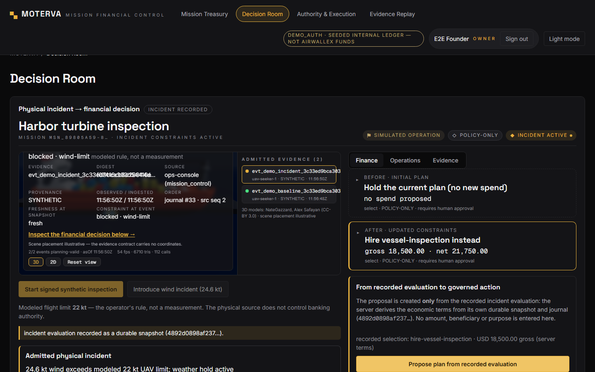
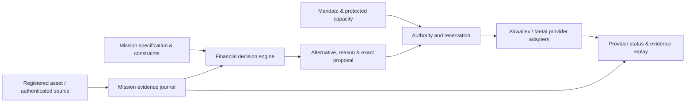

# MOTERVA

### When the mission changes, the money should know.

**Mission Treasury for the physical world.** MOTERVA turns changes in field operations into explainable financial decisions — with the evidence, spending rules, approvals, and resulting provider state linked to the same mission.

An inspection drone is grounded by wind. Waiting risks the deadline. Sending a vessel costs money. Spending without authority risks the whole operation. **MOTERVA makes that trade-off explicit:** what is still operationally feasible, what it will cost, what the mission can afford, and who must approve the next move.

This is the space between operational software that understands machines and financial software that understands money.



## The product

Most operating teams already have separate ways to monitor assets, coordinate contractors, and manage payments. When the situation changes in the field, the consequential financial decision still has to cross those boundaries.

MOTERVA gives each mission a **financial operating context**: an objective, physical assets, operating limits, supplier alternatives, budgets, protected reserves, and explicit authority. New evidence can change the recommended plan without changing the underlying rules about who is allowed to spend.

| Surface                   | What an operator can do                                                                                            |
| ------------------------- | ------------------------------------------------------------------------------------------------------------------ |
| **Mission Treasury**      | Understand available money separately from reserved commitments and mission exposure.                              |
| **Mission Setup**         | Define assets, source identities, policy thresholds, supplier economics, and an authorized spending envelope.      |
| **Decision Room**         | See physical conditions alongside feasible financial alternatives, decisive reasons, and the next governed action. |
| **Authority & Execution** | Review exact terms, propose a plan, require a different authorized approver, and inspect operation/provider state. |
| **Evidence Replay**       | Follow the sequence from source observation through evaluation, mandate, approval, reservation, and receipt.       |

### One mission, one change, a different financial answer

In the included **harbor inspection scenario**, the baseline produces a no-new-spend decision. A signed sample wind incident then makes the incumbent aerial inspection infeasible under the configured safety policy. The evaluation changes to an eligible vessel-inspection alternative, with the blocked incumbent and economic reasons visible beside the physical scene.

Those choices are calculated by the mission engine from its cataloged scenario inputs; they are not hardcoded by the React page. The same production mission pathway also accepts **customer-authored specifications and newly signed source observations with unfamiliar asset, supplier, and price values**. The harbor visualization is illustrative, not independently surveyed positioning or real vehicle control.

## Who we are building for

**First wedge: inspection fleets and asset-intensive operators.** Think maritime inspection contractors, industrial drone teams, and the operations/finance leaders who must react to grounded equipment, weather windows, urgent subcontractors, and constrained mission budgets.

The buyer's question is not “Can AI pay an invoice?” It is **“When the physical plan breaks, what can we still do — and what are we actually authorized to fund?”**

The longer-term opportunity is an evidence-to-expenditure layer shared across missions and industries: physical systems contribute observations, policy determines feasible actions, authorized people control exceptions, and financial rails report their independent outcomes. This is a **commercial thesis to validate**, not a claim of established customers, revenue, or quantified savings.

[Read the product narrative, buyer thesis, and submission-ready description](docs/PRODUCT_NARRATIVE.md).

## How MOTERVA works



**1. Evidence with identity.** A mission registers its assets and accepted sources. Source credentials are issued through a permissioned API, sealed at rest, and used to authenticate submitted FIELD observations. Freshness, provenance, tenancy, sequence, and source ownership are checked; unconfigured customer missions never silently inherit a sample harbor specification.

**2. Decisions from constraints, not unconstrained prompts.** The policy engine evaluates operational feasibility and mission economics, including waiting, declining, escalation, or a supplier alternative. Optional bounded model assistance can interpret an unstructured report into validated typed evidence, but cannot set mandates, clear safety conditions, approve payments, or invent financial authority. The engine still works when no model provider is configured.

**3. Money remains governed.** Proposals bind exact amount, currency, beneficiary, purpose, and decision evidence. Mandates and separate-role approvals constrain what can proceed. Transactional reservations, an outbox, original request identities, and conservative provider status handling guard against duplicate or over-budget commitments.

**4. A case can be reconstructed.** The append-only evidence journal links the operational change to the selected candidate, refusal reasons, authorization, operation, and any independently retrieved provider response. A provider submission is not a settlement; a source-authenticated claim is not independently verified sensor truth.

**5. Physical context stays useful.** The interactive 3D mission viewport supports the registered single-aerial harbor case, including changing constraints and synchronized evidence. Ground-only, unsupported, unconfigured, and WebGL-unavailable contexts use honest non-spatial or 2D presentations rather than invented geography.

## Try the product locally

**Requirements:** Node.js 24+, npm 10+. No cloud account, bank credential, or external database is required to explore the local operating scenario.

```bash
npm ci
npm run build
```

Run these in **two terminals** from the repository root:

**Terminal 1 — authenticated local scenario and API**

```bash
node e2e/scripts/demo-auth-server.mjs
```

**Terminal 2 — the built product**

```bash
npm run preview -w @moterva/web
```

Open **http://127.0.0.1:4173**. Use the local test-only credentials printed by the API startup script, select **Harbor turbine inspection**, and follow the baseline → wind incident → changed decision → governed proposal → Evidence Replay sequence.

This launcher intentionally creates a disposable, seeded SQLite environment. Its sample operating observations and balances are not live financial or sensor measurements; restarting the launcher creates a fresh local scenario. It is **not** a production authentication configuration.

For ordinary code development, `npm run dev` runs the API at `127.0.0.1:8787` and the Vite development server at `127.0.0.1:5173`. Production identity, secrets, and deployment are configured separately.

## Verify the engineering

```bash
npm run check:secrets
npm run check:docs
npm run lint
npm run format:check
npm run typecheck
npm run test:unit
npm run test:e2e
```

Playwright requires Chromium installed on the test host (`npx playwright install chromium`). The suite exercises real API, ledger, identity and browser processes rather than a static Figma-style walkthrough. Among the covered behaviors are fresh mission configuration, authenticated source ingestion, changed-policy decisions, separate approvals, cross-tenant refusals, credential recovery, unknown provider states, and responsive 3D/2D rendering.

**Code map for technical reviewers:**

| Area                                                          | Source                                                     |
| ------------------------------------------------------------- | ---------------------------------------------------------- |
| Mission specification, signed ingestion, evaluation endpoints | [`apps/api/src/integration/`](apps/api/src/integration/)   |
| Typed constraints and candidate evaluation                    | [`packages/planner/`](packages/planner/)                   |
| Financial authority, commitments, outbox, evidence            | [`packages/ledger/`](packages/ledger/)                     |
| Airwallex sandbox adapter and receipt reconciliation          | [`packages/airwallex/`](packages/airwallex/)               |
| Metal testnet mandate/commerce integration                    | [`packages/metal/`](packages/metal/)                       |
| Mission UI and physical viewer                                | [`apps/web/src/`](apps/web/src/)                           |
| Security tests and unfamiliar-input customer proof            | [`apps/api/test/integration/`](apps/api/test/integration/) |
| Browser journeys                                              | [`e2e/`](e2e/)                                             |

The stack is React 19 / Three.js, Fastify, TypeScript, Node.js, SQLite with transactional concurrency controls, and server-side provider adapters. A single-app deployment path uses AWS, Cognito/OIDC, an encrypted EBS ledger volume, TLS and immutable release images, avoiding unnecessary microservices.

## Integration and operational status

These are distinct claims. A connector implemented in code is not the same thing as an externally completed transfer.

| Boundary                            | Current evidence                                                                                                                                                                                                                             |
| ----------------------------------- | -------------------------------------------------------------------------------------------------------------------------------------------------------------------------------------------------------------------------------------------- |
| **Operational-to-financial engine** | Implemented; unfamiliar-input signed FIELD scenarios, decision changes, authorization refusals, restart recovery and browser journeys tested.                                                                                                |
| **Airwallex**                       | Sandbox authentication, balance and beneficiary reads have been observed. A guarded transfer adapter and two-credential prepare/confirm workflow are implemented and tested; **no live sandbox transfer is claimed as executed or settled**. |
| **Metal**                           | A funded testnet wallet, live seller payment offer and refusal/plan-only checks have been observed. **No completed signed purchase is claimed**.                                                                                             |
| **Model assistance**                | A bounded HTTP model adapter is implemented and optional. No live provider invocation is claimed in the current release evidence; deterministic policy evaluation remains available.                                                         |
| **Hosted production**               | AWS provisioning, OIDC, key custody, persistence and boot controls have automated test coverage. **Public deployment and live owner-login verification are still pending**.                                                                  |
| **Market**                          | Intended customers and pilot outcomes are hypotheses; no paying customers or verified ROI are claimed.                                                                                                                                       |

Relevant references: [State and evidence log](docs/STATE.md) · [Financial security boundaries](docs/05_FINANCIAL_SECURITY_AND_PROVIDER_GATES.md) · [AWS deployment runbook](docs/release/AWS_DEPLOYMENT.md) · [Airwallex connection proof](docs/contracts/airwallex-connection-proof.md) · [Product positioning and presentation](docs/PRODUCT_NARRATIVE.md).

## Built to become a company

A production buyer will judge MOTERVA on whether it reduces the time from an incident to a defensible decision, keeps commitments within authority, and makes payment exceptions recoverable. Those are the outcomes we intend to validate with design partners, not benefits we claim to have already measured.

The product begins with an inspection mission but is architected around **registered missions, independent sources, typed constraints and governed financial actions**, not a single hardcoded drone scenario. The aim is to let companies extend their existing operations and banking systems without surrendering control of either.

MOTERVA is the product name; the repository retains its original `Morteva` name. Developed during the [Airwallex Agentic Banking Hackathon](https://airwallex.hackerearth.com/); company ambitions, product status and external verification remain separate.

---

**The promise:** a change in the physical world should produce a financial decision people can understand, authorize, and audit.
